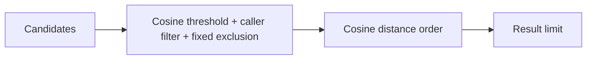

# Fixed Exclusion for v4 Search



## What it does

Adds a mandatory metadata exclusion to `public.match_thoughts`. A caller's filter cannot
re-include excluded rows, and excluded nearest neighbors cannot consume result slots.
This companion builds on Nate B. Jones's [Open Brain](../../docs/01-getting-started.md).
Nate shares more practical systems in his [newsletter](https://substack.com/@natesnewsletter)
and on his [site](https://natebjones.com).

A row is excluded when its metadata is SQL NULL or a non-object JSON value; when a present
`sensitivity` value is not a JSON string; when that string, lowercased and trimmed, equals
`restricted`; or when `journal` appears anywhere in the lowercased metadata serialization.
The last condition includes keys, nested values, and substrings. This broad exclusion is
intentional. An object without `sensitivity`, including `{}`, remains eligible if it has no
such marker. The CASE expression handles SQL NULL without accidentally rejecting that object.

The migration changes only the WHERE predicate. It retains the function signature, defaults,
return columns, cosine comparison, ordering, limit, PL/pgSQL language, invoker security,
volatility, search path, ownership, and existing execution grants. It changes no stored rows.

## Prerequisites

- PostgreSQL 17 and pgvector 0.8.0; the synthetic proof used PostgreSQL 17.12.
- An isolated, empty disposable database for the tests, with `vector(1536)` embeddings.
- A privately captured, reviewed definition of the installed function. Its signature must be
  `public.match_thoughts(vector, double precision, integer, jsonb)` with defaults `0.7`, `10`,
  and `'{}'::jsonb`, and the same definition as [schema.sql](schema.sql) outside the added CASE.
- Verify PL/pgSQL, SECURITY INVOKER, VOLATILE, and search path `pg_catalog, public, extensions`.
  Record the existing owner and grants; do not replace them with guessed values.
- Independent review and an explicit deployment decision before applying to a real database.

## Step-by-step instructions

1. Prepare the empty synthetic database. Set `TEST_DATABASE_URL` to that disposable database
   and `REVIEWED_BASELINE_SQL` to the reviewed baseline definition file. Keep connection details
   and operational receipts outside this public repository. Enable vector and create this
   fixture table in the **disposable database only**:

   ```sql
   CREATE EXTENSION vector VERSION '0.8.0';
   CREATE TABLE public.thoughts (
     id uuid PRIMARY KEY,
     content text NOT NULL,
     metadata jsonb,
     embedding vector(1536),
     created_at timestamptz NOT NULL DEFAULT now()
   );
   ```

2. Install the reviewed baseline there and freeze the bytes of [tests.sql](tests.sql).
   Run the fail-first proof before applying the migration:

   ```sh
   psql "$TEST_DATABASE_URL" -X -v ON_ERROR_STOP=1 -f "$REVIEWED_BASELINE_SQL"
   psql "$TEST_DATABASE_URL" -X -v ON_ERROR_STOP=1 -f schemas/v4-search-exclusion/tests.sql
   ```

   The expected baseline result is exactly five failed groups, `T1` through `T5`, with all
   17 `C` controls passing, followed by `EXCLUSION_ASSERTIONS_FAILED: 5` and psql exit 3.
   Each group checks actual function results against synthetic row identities. T5 also puts
   excluded candidates ahead of the best eligible candidate and requests one result.
   Stop on any other result. The connection closes the failed transaction, reverting fixtures.

3. Apply the migration in that disposable database, then run the **same frozen file**:

   ```sh
   psql "$TEST_DATABASE_URL" -X -v ON_ERROR_STOP=1 --single-transaction -f schemas/v4-search-exclusion/schema.sql
   psql "$TEST_DATABASE_URL" -X -v ON_ERROR_STOP=1 -f schemas/v4-search-exclusion/tests.sql
   ```

   Expect 22 passes, zero failures, and exit 0. The test transaction rolls back all fixtures.
   Compare function properties, owner and ACL before/after, and verify that the original
   definition bytes outside the inserted predicate are unchanged. Keep red and green outputs.

4. After review and a separate deployment decision, recheck the installed definition and
   properties against the reviewed baseline before applying. A mismatch requires a new decision.
   Use count-only positive baselines and an ordinary eligible control for the later deployment
   readback. An empty baseline or an absent synthetic marker cannot prove exclusion.

## Expected outcome

The synthetic suite has 38 fixtures and 22 assertions: five exclusion groups and 17 controls
covering eligible metadata, containment, returned types and values, strict thresholds, ranking,
limits, defaults, NULL arguments, NULL embeddings, and empty results. There are no skipped or
expected-failure assertions in the passing run. A successful synthetic test does not establish
deployment, production counts, or application-level behavior.

## Troubleshooting and limitations

- **Nonempty table or wrong vector dimension:** stop and bind the correct disposable database.
  Do not erase an existing table to make a test pass.
- **Unexpected baseline failure or failed candidate assertion:** preserve the outputs and stop.
  Do not change the frozen assertions to accommodate the result.
- **Installed definition differs:** this migration is for the exact reviewed v4 definition.
  Review the difference instead of overwriting an unrelated function variant.
- **A benign metadata value contains `journal`:** broad substring exclusion is intentional;
  a caller filter cannot override it. Any policy change requires separate review.
- **Access is denied:** the function remains SECURITY INVOKER and preserves existing grants.
  This migration does not grant table access or change row security.

The fixture proof uses exact scans on a small empty test table. It does not measure approximate
index recall, production query plans, latency, or external clients. Server cleanup belongs to
the owner of the disposable facility. No rollback that restores unsafe search is automatic.
